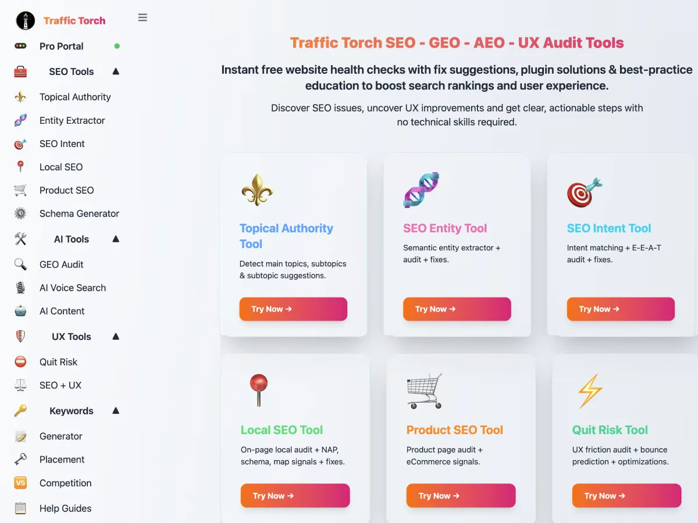

# Traffic Torch 🚥

**Instant 360° SEO, UX and AEO auditing — with a community of practitioners who share what they find.**

Run any of 17 audit tools against a URL, get a 0–100 score with a per-module breakdown, and post the result as a shareable **torch**. Endorse the best audits, follow other SEOs and designers, and track your own site's improvement over time.

[](https://traffictorch.net)
[](https://doi.org/10.5281/zenodo.20149616)
[](./LICENSE)
[](./CONTRIBUTING.md)

**Links:** [Live site](https://traffictorch.net) · [Releases](https://github.com/traffictorch/traffic-torch/releases) · [Zenodo archive](https://zenodo.org/records/20149616) · [Community feed](https://traffictorch.net/community/) · [Leaderboard](https://traffictorch.net/leader-board/) · [Developer API](https://traffictorch.net/integrations/developer/api/)

<p align="center">
  
</p>

<p align="center">
  
  
  
  
  
  
  
</p>

---

## What it is

Traffic Torch is a full auditing and community platform for people who run websites — site owners, designers, developers and SEOs. It combines:

- **17 client-side audit tools** that run entirely in the browser against any URL.
- **A public community layer** — feed, leaderboard, profiles, torches, endorsements, network, direct messages and activity.
- **A dashboard** with GA4 and Search Console integrations, audit history, real-time analytics and profile management.
- **A developer surface** — REST API, embeddable badges, RSS feeds and auto-generated Open Graph cards.

No tracking beyond standard analytics. No ads. Audits are opt-in public — you decide what you share and when.

## The 17 audit tools

Each tool produces a 0–100 score with a per-module breakdown, an educational explanation of every signal, and a fix suggestion.

| Tool | What it checks |
|---|---|
| **NUSA** | Full SEO + UX + AEO combined audit |
| **OFUX** | UX, SEO intent and AI search signals |
| **Lighthouse Plus** | 10 modules — performance, accessibility, agent-readiness |
| **AEO Performance** | Answer engine optimisation, AI crawler parsing |
| **SEO Intent** | Search intent alignment, E-E-A-T signals |
| **SEO + UX** | Combined SEO and UX health score |
| **Local SEO** | Google Maps, NAP consistency, local schema |
| **Product SEO** | E-commerce product page audit |
| **Entity Extractor** | Semantic entity extraction from content |
| **Topical Authority** | Topic and subtopic coverage gaps |
| **Schema Generator** | JSON-LD structured data generation |
| **AI Search / AEO** | Optimisation for AI Overviews |
| **AI Voice Search** | Voice query alignment |
| **AI Content Audit** | AI-generated content probability (TensorFlow.js) |
| **Quit Risk** | Predicted user drop-off risk |
| **Keyword Research** | Keyword suggestion and difficulty |
| **Keyword Placement** | On-page keyword coverage and placement |

Plus a **Keyword vs** tool for competitor gap analysis.

## The community layer

Every audit you choose to share becomes a **torch** — a public page at `/torch/:id/` with its own score, module breakdown, discussion thread, Open Graph card and permanent link.

- **Community feed** at [`/community/`](https://traffictorch.net/community/) — every shared audit, filterable by tool.
- **Leaderboard** at [`/leader-board/`](https://traffictorch.net/leader-board/) — podium, top 12, filter by tool, top contributors.
- **Public profiles** at `/torcher/:username/` — bio, skills, verified website badge, hire-me card, contacts, activity timeline, network.
- **Endorsements** — endorse high-scoring torches (80+). One per user per day, +36 points to the author. The human signal next to the machine score.
- **Beams** — private one-to-one direct messages with attachments, reactions, reply threading and real-time delivery over WebSocket.
- **Network** — a one-way opt-in follow system. See whose work you're looking at in the feed.
- **Activity feed** — a live timeline of posts, comments, endorsements, contributions and milestones. Public by default; one toggle makes it private.
- **Points** — earned from posting (+10), commenting (+5), leaderboard submissions (+10), contributions (+25) and receiving endorsements (+36).
- **RSS** — global (`/torches/feed.xml`), per-user (`/torcher/:username/feed.xml`) and per-tool (`/tools/:tool/torches/feed.xml`).

## The dashboard

Sign up to unlock:

- **Profile editor** — avatar (presets or custom photo), bio, social links, skills, contacts, hire-me card, website verification via meta tag.
- **GA4 integration** — Google OAuth, cached reports, time series, top content, traffic sources, device and country breakdown, conversion rate, CSV export.
- **Search Console integration** — OAuth, top queries and pages, country and device breakdown, CTR and position trends.
- **Real-time analytics** — 30-minute live dashboard (Enterprise tier).
- **Audit history** — saved audits with re-run and delete.
- **Push notifications** — Web Push for comments, network connections, endorsements, leaderboard updates and messages.
- **Settings** — message policy, notification preferences, password reset, billing portal, account deletion.

## Screenshots


## Tech stack

| Layer | Technology | Purpose |
|---|---|---|
| **Frontend** | Vanilla JS + Alpine.js + Tailwind CSS | Reactive UI, utility-first styling |
| **Build** | Vite | Fast dev, static build |
| **Audit tools** | Native Fetch + DOM APIs | Client-side page analysis, no backend needed |
| **AI content detection** | TensorFlow.js | Client-side model inference |
| **Hosting** | Cloudflare Pages + GitHub Pages | Edge-served static frontend |
| **Backend** | Cloudflare Workers | Auth, feed, points, endorsements, notifications |
| **Database** | Cloudflare D1 (SQLite) | Users, posts, comments, endorsements, activity, points |
| **Object storage** | Cloudflare R2 | Avatars, message attachments |
| **Real-time** | Cloudflare Durable Objects | WebSocket inbox for Beams |
| **Payments** | Stripe | Pro / Enterprise subscriptions |
| **Integrations** | Google OAuth | GA4 + Search Console |
| **Email** | Resend | Transactional email (invites, magic links, password reset) |
| **Charts** | Chart.js | Analytics visualisations |
| **PWA** | manifest.json + sw.js | Installable, offline shell, Web Push receiver |
| **SSR** | Cloudflare Worker (`torches-page-render`) | OG cards, sitemaps, RSS, `/torch/`, `/torcher/` |

## Quick start

### Use the hosted version

→ **[traffictorch.net](https://traffictorch.net)** — free tier: 3 audits per day, no signup required.

### Run locally

```bash
git clone https://github.com/traffictorch/traffic-torch.git
cd traffic-torch
npm install
npm run dev

## Community Governance

Traffic Torch has a **Round Table** — a decentralized governance system where every eligible entity has equal authority. Proposals, discussion, consensus voting, audit-chained results. No admins, no override.

See /community/round-table/ on the live site or HANDOFF.md for technical details.
